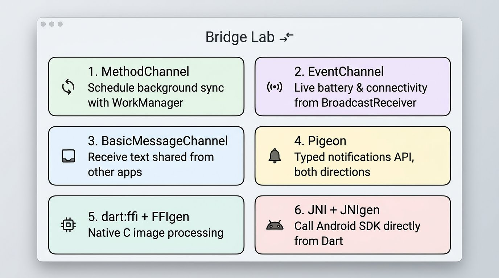
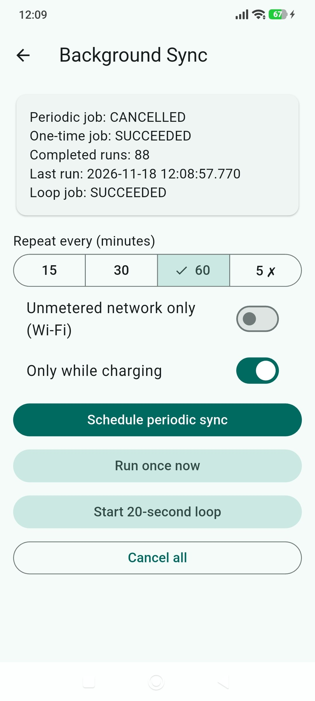
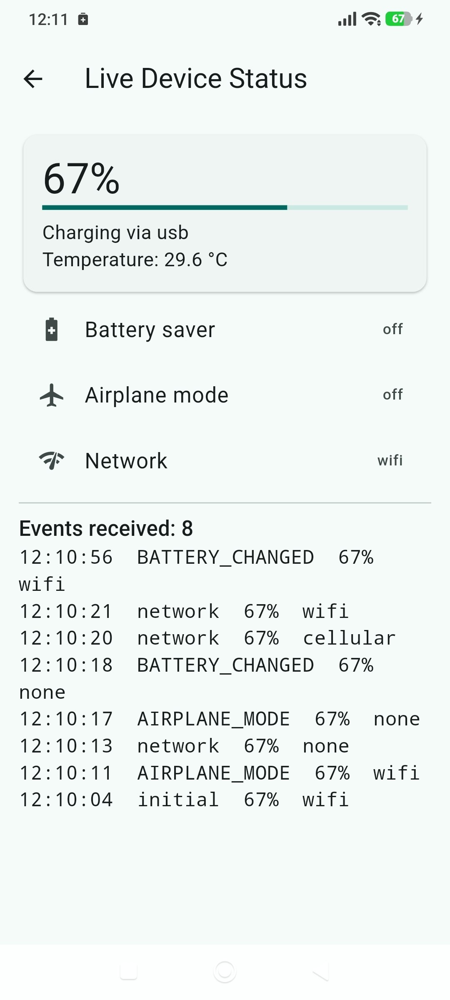
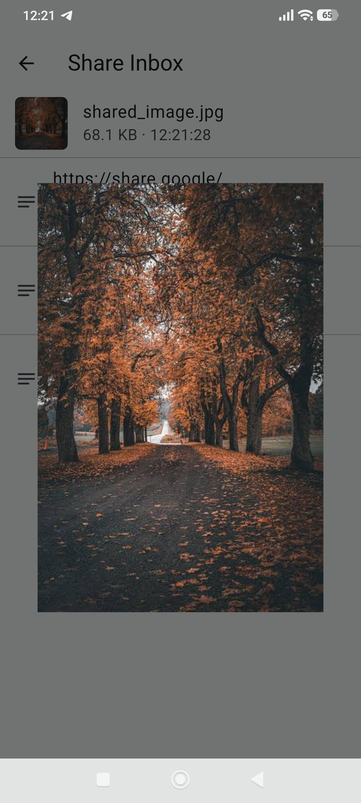
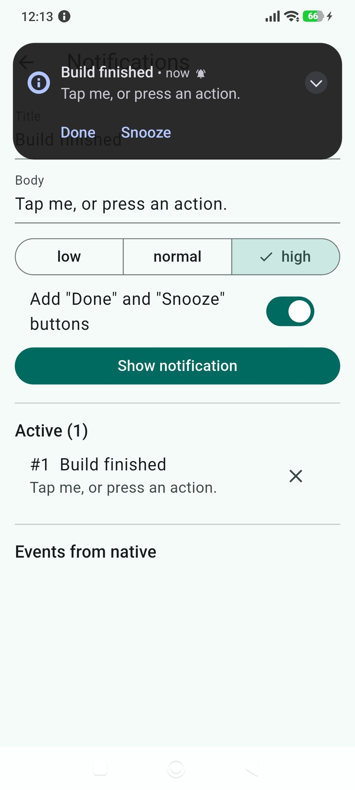
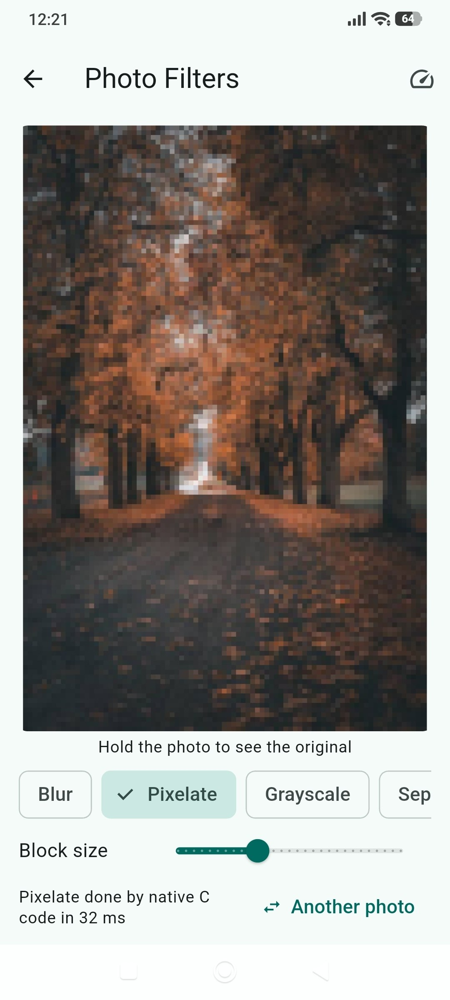
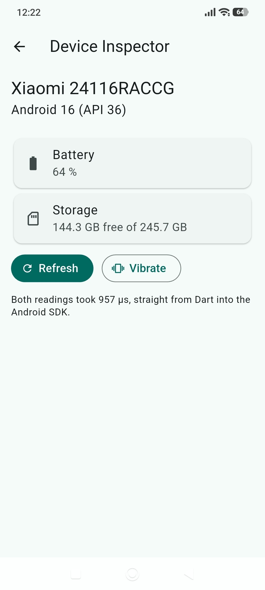
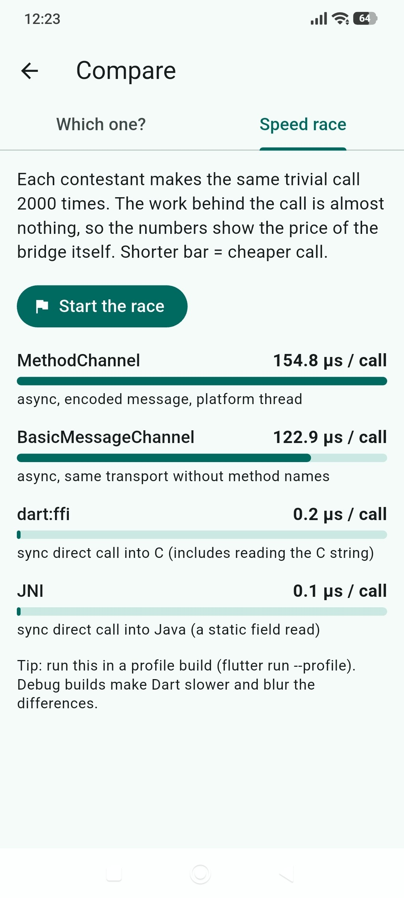

# Bridge Lab

A Flutter app (Android only) that shows **six ways to talk to Android from Flutter**, each one on its own page with a real-life use case. Built as the companion project for the article *Six Ways to Talk to Android from Flutter — and When to Use Each One*.

> Right bridge, right problem.

<!-- Add a cover screenshot: docs/screenshots/catalog_new.png -->


## The six approaches

| # | Approach | Use case in the app | Where to look |
|---|---|---|---|
| 1 | **MethodChannel** | Background sync with WorkManager | `lib/features/background_sync/` |
| 2 | **EventChannel** | Live battery and network status | `lib/features/live_status/` |
| 3 | **BasicMessageChannel** | Share Inbox: receive photos and files shared from other apps | `lib/features/share_inbox/` |
| 4 | **Pigeon** | Notifications with action buttons and events | `lib/features/notifications/`, `pigeons/` |
| 5 | **dart:ffi + FFIgen** | Photo filters written in C | `lib/features/image_lab/`, `android/app/src/main/cpp/` |
| 6 | **JNI + JNIgen** | Device inspector (battery, storage, vibration) | `lib/features/device_inspector/` |

A **Compare** page (icon in the catalog's app bar) has a decision guide ("Which one?") and a speed race that times the same trivial call through each approach.

## Screenshots

<!-- Replace the paths with your own screenshots -->
| Background Sync | Live Status | Share Inbox |
|---|---|---|
|  |  |  |

| Notifications | Photo Filters | Device Inspector |
|---|---|---|
|  |  |  |

| Compare: speed race |
 

## What each page demonstrates

- **Background Sync (MethodChannel).** Schedule, run and cancel WorkManager jobs from Dart, with charging and network constraints. Request and response, untyped.
- **Live Status (EventChannel).** A stream of battery and network changes from a `BroadcastReceiver` and a `NetworkCallback`, with proper `onListen` / `onCancel` cleanup.
- **Share Inbox (BasicMessageChannel).** Appears in the Android share sheet. A tiny native-only activity saves shared items instantly, and a `ready` handshake delivers them to Dart without losing any on cold start.
- **Notifications (Pigeon).** A typed contract with `@HostApi` (Dart calls Android) and `@FlutterApi` (Android calls Dart) for permission, show, cancel, and action events.
- **Photo Filters (dart:ffi).** Blur, pixelate, grayscale and sepia implemented in C, called through FFIgen-generated bindings on a background isolate. Hold the photo to see the original. A developer sheet compares four ways to run the same blur.
- **Device Inspector (JNI).** Android SDK classes (`Build`, `BatteryManager`, `StatFs`, `Vibrator`) called directly from Dart through JNIgen-generated bindings, with no Kotlin written.

## Project structure

```
lib/
  app/                  navigation and the list of approaches
  core/                 shared types
  features/
    catalog/            home screen
    background_sync/    MethodChannel
    live_status/        EventChannel
    share_inbox/        BasicMessageChannel
    notifications/      Pigeon
    image_lab/          dart:ffi
    device_inspector/   JNI
    compare/            decision guide and speed race
pigeons/                Pigeon contract
android/app/src/main/
  kotlin/.../           MainActivity, ShareReceiverActivity
  kotlin/.../bridges/   native side of every bridge
  kotlin/.../work/      WorkManager worker
  cpp/                  C code and CMakeLists.txt for FFI
ffigen.yaml             FFIgen configuration
jnigen.yaml             JNIgen configuration
```

## Requirements

- Flutter (stable) and an Android device or emulator
- Android Studio with the **NDK** and **CMake** installed (SDK Manager → SDK Tools)
- JDK 17 (the one bundled with Android Studio works)
- Only if you regenerate FFI bindings: **LLVM** (provides `libclang`)

## Run the app

```
flutter pub get
flutter run
```

Do a full restart (not hot reload) after changing native Kotlin or C code. For meaningful numbers on the Compare page's speed race, run a profile build:

```
flutter run --profile
```

## Regenerating generated code

The `*.g.dart` and `*.g.kt` files are committed. You only need to regenerate them when you change a contract.

**Pigeon** (after editing `pigeons/notifications.dart`):

```
dart run pigeon --input pigeons/notifications.dart
```

**FFIgen** (after editing `image_lab.h`):

```
dart run ffigen --config ffigen.yaml
```

On Windows, FFIgen needs LLVM installed, and `compiler-opts` in `ffigen.yaml` must point at LLVM's clang include folder (use the short `PROGRA~1` path form to avoid spaces). `compiler-opts` must be at the top level of the YAML.

**JNIgen** (after editing the `classes` list in `jnigen.yaml`):

```
flutter build apk --debug
dart run jnigen --config jnigen.yaml
```

Notes for JNIgen:

- `versions` must be quoted strings, for example `['36']`.
- `sdk_root` must point at your Android SDK. JNIgen expects platform folders named `android-<integer>`; a folder such as `android-37.0` breaks it, so point `sdk_root` at a folder holding a copy under a plain name.
- The Android `Context` comes from the `jni_flutter` package (`androidApplicationContext`).

## Things worth knowing

- **Android only.** Everything here targets Android; JNI in particular has no iOS equivalent.
- **Permissions.** Notifications need the `POST_NOTIFICATIONS` permission (Android 13+). Vibration needs `VIBRATE` (granted automatically). The live status page needs `ACCESS_NETWORK_STATE`.
- **Generated APIs change between versions.** Pigeon, FFIgen and JNIgen output depends on the tool version. If something doesn't compile after an upgrade, read the generated file first.
- **Demo shortcuts.** The Background Sync "loop" mode re-schedules the worker so you can watch it run every minute. WorkManager's real minimum for periodic work is 15 minutes. Don't copy the loop into production code.

## Article

Read the full write-up: **[add your Medium link here]**

## License

[Choose a license, for example MIT, and add a LICENSE file.]
